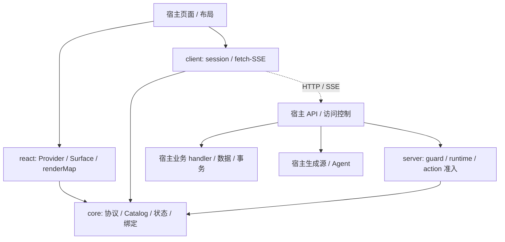

# ARCHITECTURE — SDK 架构与接入模型

更新：2026-10-23。本文同时描述现状和已决策目标，各节显式标注。需求见 [PRD](PRD.md)，字段与 wire 契约见 [SPEC](SPEC.md)，取舍见 [DESIGN](DESIGN.md)，实施状态只见 [CURRENT](tasks/CURRENT.md)。目标图与示意 API 不代表当前已经交付。

## 1. 系统定位与架构约束

Nexus 是嵌入宿主应用的 Agent UI Runtime。它消费候选 A2UI 消息，执行宿主声明的组件与交互约束，维护可渲染状态，并把 action 交给宿主注册的处理器。宿主拥有布局、设计系统、业务事实、身份权限和副作用。

架构遵循以下约束：

- core 不依赖 DOM、React、HTTP、Node API 或业务模型。
- Catalog/schema/绑定规则只有一份通用解释实现，前后端复用；服务端仍独立校验所有不可信输入。
- 生成源、Host Policy、handler 与状态实现由宿主显式装配；SDK 不依据业务词或模型凭证选择流程。
- surface、run 与业务 operation 是三种不同状态；SDK 不承诺业务事务或 exactly-once。
- 一切消费方只依赖公开入口；示例与参考服务不向 SDK 反向提供实现。
- 未实现的生命周期与安全保证必须作为差距记录，不能靠架构图宣称完成。

## 2. 仓库、模块与依赖

### 2.0 当前仓库布局

```text
Nexus_UI/
├─ packages/
│  ├─ nexus-core/             现有协议、Catalog、状态与绑定内核
│  ├─ nexus-react/            现有 Provider、renderer、17 标准组件
│  └─ nexus-server/           SDK 装配、guard、SSE 传输（参考服务已迁出，无 src/main.ts）
├─ web/nexus-playground/      开发者试验台前端，/api 代理到参考服务 3001
├─ examples/
│  ├─ playground-server/      参考服务：演示 Catalog、LLM/mock 生成源、本地 Koa 装配（只经公开入口消费）
│  ├─ standalone-host-demo/   公开入口接入与后续仓外验收载体
│  └─ agent-demo/             业务应用占位，由应用自行定义场景
├─ specification/v0_9/        上游协议与指南快照
└─ docs/                     PRD / SPEC / ARCHITECTURE / DESIGN / tasks/CURRENT
```

当前依赖为 `react → core`、`server → core`、`playground-server → core + server`；浏览器流处理散在 playground 与 standalone-host-demo。client 包尚不存在。自定义交互和非 Koa 接入尚未完成。参考工厂显式装配自己的演示 Policy，SDK 缺省 Policy 保持中立。

三包构建先清理各自 dist，再编译并完成现有 ESM import 修补；根 build/build:packages 串行执行，避免依赖包清理竞态；产物清单对照当前 src，防止源码迁出后遗留旧 listener、模型 SDK、业务模块或测试。此为 S1 产物卫生检查，不替代 S5 的仓外发行验收。

### 2.1 已决策的目标包图



箭头为代码依赖；虚线为通信。client 与 server 不互相 import 实现，React 不强依赖 client。共享的纯消息、运行元数据与组件能力类型放在 core；请求读取、SSE framing 和 HTTP 对象留在适配层。

目标新增 `packages/nexus-client/`，先只提供浏览器会话与 fetch/SSE。参考程序已在 `examples/playground-server/`，只通过 SDK 根入口消费三包/后续四包。现有 web 路径保留，不为整齐重命名无关目录；根 dev/递归脚本已随迁移更新。

不额外拆分 guard、Catalog、Policy 或 Agent 包。Node server 的根入口不启动 listener、不读取项目环境、不隐式依赖模型 SDK；Koa/RPC 适配为显式可选能力。实际产物验证框架无关入口的可加载性。

统一接入通过各包公开根入口和职责内高层 API 实现，暂不新增总门面包（DESIGN D12）。浏览器入口不重导出 Node server，框架无关入口不引入 React/后续 Vue；环境隔离不依赖 tree shaking。

### 2.2 模块职责与验收归属

| 模块            | 负责                                                                          | 验收归属                                   |
| --------------- | ----------------------------------------------------------------------------- | ------------------------------------------ |
| core            | 协议/Profile、Catalog/schema、JSON Pointer、状态更新、VNode、输入/action 原语 | conformance、纯状态与安全反例              |
| client（目标）  | run/surface 会话状态、预览与提交协调、终态、取消、恢复、transport 适配        | headless 会话测试与浏览器接入              |
| React           | runtime/context、按 surface 订阅、组件映射与交互门控                          | 布局嵌入、多 surface、自定义控件与可访问性 |
| server          | 候选准入、surface 快照、action 输入准入、调度与提交；Koa/RPC 薄适配           | 通用运行测试、HTTP 时序与资源反例          |
| playground      | 模型装配、联系人/任务/Workbench 演示、调试 UI                                 | 示例可用性，不决定 SDK 业务范围            |
| standalone host | 自有 Catalog、布局、控件、handler 的完整接入                                  | SDK 独立安装与集成验收                     |
| agent-demo      | 应用业务场景、数据与事务                                                      | 应用自己的 docs 与验收                     |

## 3. 信任边界与能力契约

### 3.1 四层准入

```text
不可信候选消息
  → Protocol：A2UI 信封与结构
  → Profile：Nexus 支持子集
  → Catalog：组件 / props / 绑定 / action 能力
  → Host Policy：宿主显式注入的附加规则
  → 可见预览；完整运行提交后才可 action
```

Protocol/Profile/Catalog 是 SDK 的通用机制；Host Policy 的具体业务规则由宿主拥有。原型防护、安全 URL 使用、正则与资源限制不能被一次业务 Policy 覆盖绕过。prompt contract 只帮助生成。

Catalog hash 固定当前契约内容，不是权限证明。已提交 surface 快照证明“SDK 接受过这些 UI 声明”，不证明模型写入的金额、对象 ID 或审批资格是真实业务事实。宿主使用可信身份与服务端数据再判业务可执行性。

### 3.2 扩展契约（目标）

组件契约在 schema 与能力声明处定义，React 只实现视图；标准组件可复用同样的声明。展示、输入与 action 三条扩展路径都必须可用：

| 扩展        | 宿主提供                                             | SDK 解释                           |
| ----------- | ---------------------------------------------------- | ---------------------------------- |
| 展示组件    | props schema、能力声明、renderMap                    | 属性/绑定校验与 VNode 映射         |
| 输入组件    | 可写绑定属性、值 schema、允许编辑的路径、renderMap   | 本地写回、最新输入收集与服务端提取 |
| action 组件 | action 挂载能力、action/参数声明、handler、renderMap | 来源核对、参数构造与分发           |

首发不提供任意代码执行、任意 dataModel deep-merge 或业务规则 DSL。Catalog schema 子集明确版本化，非法/不支持的配置初始化即报错。自定义组件不能依赖在 runtime 中增加组件名分支。

## 4. core：消息与状态

### 4.1 当前流水线（保留）

```text
push(chunk) ─ JSONLBuffer ─ JSON.parse ─┐
                                     ├→ Protocol → Profile → Catalog（配置时）
dispatch(message) ────────────────────┘
  → surface 生命周期校验
  → CoreStore：surfaces / componentsBySurface / dataModelBySurface
  → buildTree：扁平组件表 → VNode
  → onRender(root, surfaceId)
```

单条非法消息记录结构化错误并丢弃，同 chunk 后续消息可继续；这只是单消息接受语义，不承诺运行级回滚。组件/dataModel 可渐进到达，缺失引用显示占位。

CoreStore 每 runtime 一份，按 surfaceId 隔离。JSON Pointer 更新不可变；树构建使用显式栈、环检测、共享子树 memo、节点/深度预算。继续使用有界整树重建，不自研 reconciler。

### 4.2 目标状态接口

core 提供稳定订阅、状态快照/恢复与受控写回原语；订阅可解除，快照适合 React 稳定读取。client 基于这些原语隔离预览、已提交视图和用户本地输入草稿。core 不读取 SSE done，也不拥有网络连接。

输入绑定和 action context 仍由 core 的通用解释器解析。组件能力来自 Catalog；读/写路径必须防保留段与继承链，值按声明校验。原始低层 runtime 继续支持宿主本地消息流；高层 client 管理的 surface 经 client 的门控 action 出口提交。

## 5. client 与 React：嵌入已有应用（目标）

### 5.1 组合模型

client session 创建并持有稳定 runtime、运行状态和 transport；React Provider 接收 runtime 与按 surface 的交互状态订阅。无网络场景由宿主直接提供 core runtime，默认使用低层消息语义。

```text
宿主创建 session / 或本地 runtime
  → Provider：上下文与订阅
    → 宿主自己的布局
      → Surface(surfaceId=A)
      → 宿主表单 / 导航 / 其他内容
      → Surface(surfaceId=B)
```

目标公开名称为 `createClientSession` 与 `A2UISurface`；具体类型签名随实现切片锁定，当前未导出。Provider 不输出固定 div；Surface 决定渲染位置并按 id 独立订阅。更新/删除 B 不清空 A，Provider 配置重渲不重建 runtime。

外部 runtime/session 由创建者销毁；Provider 自建 runtime 在卸载时释放。视图层使用可取消且稳定快照的订阅，避免 React 并发渲染下的状态撕裂。标准样式显式选择，不在 import 时注入全局动画。

### 5.2 会话层承担的完整路径

```text
发起生成 / action
  → 创建 run，关闭该 surface 的提交入口
  → fetch/SSE：核对 start / version / runId / revision / hash
  → message 经 core 校验，更新隔离预览
  → done：核对成功提交与本地校验，发布新视图并开放 action
  → error / cancel / 缺失终态：丢弃预览，按 commitState 决定是否失同步
```

EOF 不是 done。失败后可以保留上次已提交视图展示，但提交结果未知时不能继续执行其 action。取消须关闭 reader/监听器并阻止晚到事件覆盖新 run；frame、响应大小和处理时间有上限。恢复使用重新生成或宿主提供的受控快照；不盲目重发业务操作。

会话层与 React 同时执行交互门控：标准/自定义动作组件反映禁用态，动作出口也核对当前 revision 可提交。一个组件忽略 disabled 不能绕过 session 门控。

S2.5 在完整 session 抽取前，通过生成/action 响应头 `X-Nexus-Run-Id` 关联本地流，与已在 S2.4 接通的成功 done 固定结果核对；按 surfaceId/runId 查询仅用于核对该次运行结果。结果由 server 在提交边界保存，不能由最新快照事后拼装；浏览器只有在同一运行成功、本地消息校验通过且关联字段吻合时才把视图和基准成对启用。S3 继续复用同一结果类型并补齐完整 Session 生命周期；仅查询元数据不构成视图恢复。

## 6. server：准入、运行与 HTTP 分离（目标）

### 6.1 模块分层

```text
宿主 API：认证、可信请求上下文、surface 访问准入
  → Koa / 自定义 HTTP 适配：解析 envelope、及时占用响应、访问钩子接线
  → AgentRuntime（S3 目标，公开工厂 createAgentRuntime）：
      单一调度（每 surface 队列）、快照、输入/action 准入、候选 guard、
      UI 提交、Session 事件源、预算与取消收敛
  → 宿主注入的生成源 / handler
  → 运行事件（start/message/done/error，SPEC §5.4）
  → HTTP 适配：SSE 序列化、背压、断开与收尾
```

**目标结构（S3.1 锁定，2026-10-22；实施随 S3.2–S3.6）**：server 新增运行模块承载 `AgentRuntime` 工厂、每 surface 调度器与 Session 事件源；adapter 保持 Catalog 固定副本、handler 表、Policy 与 store/ledger/manager 的单一所有者身份，`prepareGeneration/prepareAction` 降级为委托同一调度的兼容外壳。调度覆盖 generation 与 action 全链（快照读取 → 准入 → resolver → handler → 提交），提交事实三态（committed/notCommitted/unknown）由 store 结果契约驱动（SPEC §6.3）。Koa 适配退为薄 sender：响应占用、SSE 序列化、背压与连接清理，不自建队列、不解释 Catalog、不自行提交。

**当前实施（S3.2，2026-10-23）**：`src/runtime/` 承载传输无关运行工厂、surface 调度、句柄与统一候选校验。adapter 兼容 prepare 外壳和高层 runtime 共用调度，SDK 句柄由任务消费并自动提交；原始自定义 run 经发送层包装后也复用运行模块。旧 HTTP 全局队列与 adapter action 私有锁已删除；调度以记录所有者身份关联，显式共用 runManager 的入口不能另建第二个 scheduler，默认不同实例仍隔离。action 入队请求深拷贝；排队取消立即释放额度；manager 的提交前失败记录异常不阻断句柄终态，诊断与实际持久记录分开。sender 接通自身 signal，SDK 句柄分支仅转发事件与管理连接；自定义 run 接线的进一步收口归 S3.5，提交事实隔离、完整 Session 与资源硬预算分别仍待 S3.3/S3.4/S3.6。

发布路由强制读取实际 adapter 的 Catalog 并核对声明 hash；adapter 每个 Catalog 首次发布/执行时固定副本，外部修改不能造成发布/执行分裂。onboarding 发布与消费共用内部完整校验（注册闸门、版本、hash、标准 prompt），无独立 executionRegistry 权威。按 surfaceId/runId 查询只读同一 runManager 中的固定结果；响应头在占用响应时写入。verifier 消费实际响应目的流并等待收完，使用成功 done 固定基准；报告 actionContext 是 handler 实际收到的权威参数隔离副本。RPC 完整序列化与并发关联复核已完成。**消费方迁移（S2.6，2026-10-20）**：两个参考服务经实际入口发布执行 Catalog（发布列表取自 adapter 固定声明）、宿主侧 surface→Catalog 映射提供精确可编辑白名单；两个参考浏览器在挂载前校验契约（版本/身份/Web Crypto 复算 hash/标准 prompt/注册闸门）、以 `X-Nexus-Run-Id` 响应头关联成功 done 并核对 catalog/hash、请求代次在逐帧写入前核对，取消/切换 Catalog/卸载立即失效、在途重复 action 忽略、生成只接受本次创建且含 root 的请求 Catalog 视图（拒绝 done-only 贴旧视图）、按发送快照确认草稿并恢复请求期间的新编辑为可见本地草稿（core `extractLatestInputDrafts`/`confirmInputDrafts`）；两组无关 Catalog（Basic 表单、中立 scorecard）完成连续两次 action 与双 surface 隔离 headless 对测。hash 以 JSON 传输形状规范化后计算，省略字段与显式 undefined 等价。上述消费方边界于 2026-10-21 复审修正；完整调度/背压/commitState 归 S3，Session 与 client 包归 S3/S4。

运行模块不接受 Koa Context，不通过 HTTP 层回写 `streamClaimed` 来转移锁所有权。Koa 适配器保留已有调用时响应占用语义；相同运行在非 Koa 消费中无需伪造 Context。Host 可保留自己的路由与认证栈，不必启用参考 router 的全部端点。

### 6.2 生成与 action 顺序

生成：检查依赖/预算/访问准入 → 调度 → 候选逐条 guard → 预览事件 → 完整性校验 → 发布 UI revision → done。声明的 onCommit/观测不伪装为与业务库的跨存储事务。

action：访问准入 → 进入 surface 调度 → 读取已提交快照 → 核对 revision/hash/来源与 action → SDK 重放检查 → 提取声明过的最新输入 → 重新解析并校验参数 → Host handler → patch 基于已提交快照校验 → 发布新 UI revision → done。

handler 在排队准入完成后调用。输入只形成临时模型；未经接受的浏览器内容不直接改服务端快照。宿主从可信上下文查询业务事实并执行事务；其返回的 patch 仍是候选输出。

### 6.3 调度、存储与所有权

当前 S3.2 实现（2026-10-23）：每 surface 调度覆盖读取快照、准入、handler、候选与提交；正常 source EOF 后由调度任务做完整校验再提交，不提前释放调度权。store 比较读取时 revision + epoch，实例级单调计数器在删除/淘汰后继续递增；准入与 guard 使用固定 Catalog，输入基础模型先于 handler patch 应用。HTTP 不补当前基准、不换 actionId，done 返回本次固定结果；运行结果留存与查询延续 S2 语义。自定义原始 run 的手动非 HTTP 消费仍需显式 commit/onError/dispose；完整 Session 与 client 生命周期由 S3/S4 后续切片收口。

同一 server runtime 每个 surface 一个调度所有者，覆盖 handler 和最终提交，不由 transport 再建队列。跨 surface 可并行，但活动 run、排队长度、消息量和内存有明确预算。所有监听器、源迭代器和锁都在终态或 dispose 路径释放。

S3.1 锁定（2026-10-22）：调度队列按 runtime 实例隔离、generation 与 action 同队列 FIFO；提交事实由 store 结果契约三分（committed/notCommitted/unknown，SPEC §6.3），发布后观察者/传输失败不改写 UI 事实；ledger 留存窗口内任意已知记录拒绝重入；资源预算与活动保护定稿于 `fixtures/session-v1/budgets.json`。取消收敛、背压与字节预算的落地归 S3.6。

默认状态、ledger 和调度按实例隔离，禁止模块全局 store 把无关宿主绑在一起。UI revision 的发布点明确；已发布后连接或 history/观测失败，不得伪报未提交。默认内存重启后旧 surface 失效；可注入持久化存储，但首发不宣称多实例调度或业务幂等。

## 7. 状态、失败与恢复

| 状态                                  | 所有者                             | 保证边界                                     |
| ------------------------------------- | ---------------------------------- | -------------------------------------------- |
| A2UI surface 组件/dataModel           | core                               | 消息级接受与 surface 隔离                    |
| 预览 / 已提交 / 失同步视图            | client                             | 明确终态前不可提交；失败不泄露临时可执行界面 |
| queued/running/终态 与 UI commitState | server runtime / client 的已知视图 | 单实例运行行为；确认丢失时报告 unknown       |
| 业务 operation                        | Host                               | 领域事务、持久化幂等与结果查询               |

`done` 只证明本次 UI 提交；`error`、断线或 canceled 都不能证明业务未执行。SDK 不回滚已执行的宿主副作用，不自动重试 action。宿主可提供不透明操作关联标识，client 把结果未知交给宿主恢复流程。

当前实现没有完整 client 会话隔离；server 仍存在双锁和模块全局队列，ledger 的 failed 可能允许重入。这些属于迁移差距，不能作为已实现的上述保证。

## 8. 安全、资源与诊断

Agent JSON、浏览器事件和 HTTP 字节均按不可信输入处理。SDK 提供属性/绑定/action 的默认拒绝、安全 URL 使用、原型与继承链防护、安全正则、请求/响应与树预算。Host 提供业务授权、业务限额和部署策略；SDK 执行其访问准入结果。

当前上限与实际缺口见 SPEC §3。尤其是记录淘汰配置不等于并发硬限额、checks 的安全正则实现不等于所有 schema.pattern 均已安全。CURRENT 中既有安全挂账须用触发条件核实并闭合，再扩大公开接入。

目标所有预算可配置且非法值显式报错；超限结构化拒绝或有界降级。活动 run/ledger 不可为满足记录数量而静默淘汰。SSE 写入尊重背压，取消能打断排队与慢消费，错误日志/raw 不无界保留。

诊断区分协议/Profile/Catalog/Policy、输入、资源、传输与运行状态，并携带可获得的 surfaceId/runId/actionId。新增运行错误码属于 Nexus session 契约，不伪装为 A2UI 协议字段。日志脱敏、关联标识和宿主观测通过回调接入，不内置业务审计库。

## 9. 现状到目标的迁移

| 切片 | 内容                                                           | 必须保留的证据                                               |
| ---- | -------------------------------------------------------------- | ------------------------------------------------------------ |
| S1   | 关闭可达安全缺陷；中立默认值；参考 Agent/服务迁出              | conformance、坏输出、安全反例、原 demo 行为                  |
| S2   | Catalog v2、自定义输入/action、路径与参数准入                  | 自定义组件闭环、最新输入、只读/越权/额外字段拒绝             |
| S3   | framework-neutral server runtime 与 session 元数据；Koa 薄适配 | 取消、并发、重放、提交前后失败、await/void、非 Koa 对测      |
| S4   | client 包、Provider/Surface 分离、迁移两个浏览器消费方         | EOF/终态、预览清理、失同步、双 surface、订阅释放、浏览器验证 |
| S5   | 当前产物仓外接入、API/兼容、升级文档与发行门禁                 | 干净安装、公开入口、完整 typecheck/lint/test/build/CI        |

早期产物检查可在 S1 开始；S5 的 API 定型和最终验收在集成模型落地后进行。每个切片同步消费方，保持已交付路径可运行；新旧契约在迁移期显式版本区分，不长期保留两套通用校验实现。任务状态与精确判据只在 CURRENT 维护。

验证宿主与 Agent 尚未选定；现有 standalone 示例只提供 SDK 接入反馈，不代表已选定验证工程。应用内部架构、业务模型、表、端点、状态机与部署不属于 SDK 评审范围；仅检查公开契约消费。业务载体是否重建不阻塞 SDK 改造。
